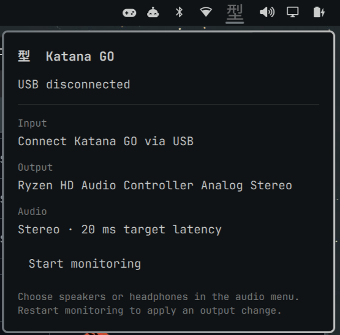

# Kata

An Omarchy bar plugin that plays your BOSS Katana GO's USB audio through your
computer's speakers or headphones.

Click **型** to open the dropdown, see the connection and audio output, and
start or stop monitoring.



## Requirements

- Omarchy with the Quattro shell
- Python 3, `pactl` with JSON support, and `notify-send`
- PipeWire Pulse or PulseAudio with `module-loopback` support
- A Katana GO connected with a USB data cable

## Install

```sh
omarchy plugin add https://github.com/mattbudde/kata.git --enable
```

## Use

Select your speakers or headphones in Omarchy's audio menu, then click **型**
and **Start monitoring**. To change outputs, stop monitoring and start it again.
Press **Escape** to close the dropdown.

The plugin requests 20 ms latency; actual latency depends on your setup.
It preserves your volume and default audio devices. No administrator access,
additional service, or runtime network connection is required.

## Remove

Stop monitoring before removing the plugin:

```sh
python3 ~/.config/omarchy/plugins/io.github.mattbudde.kata/katana-go.py off
omarchy plugin remove io.github.mattbudde.kata
```

## Development

Run `./install` for a local installation and `./check` to validate the plugin.
Checks require Omarchy and Qt 6's `qmllint`.

## License

[MIT](LICENSE).
